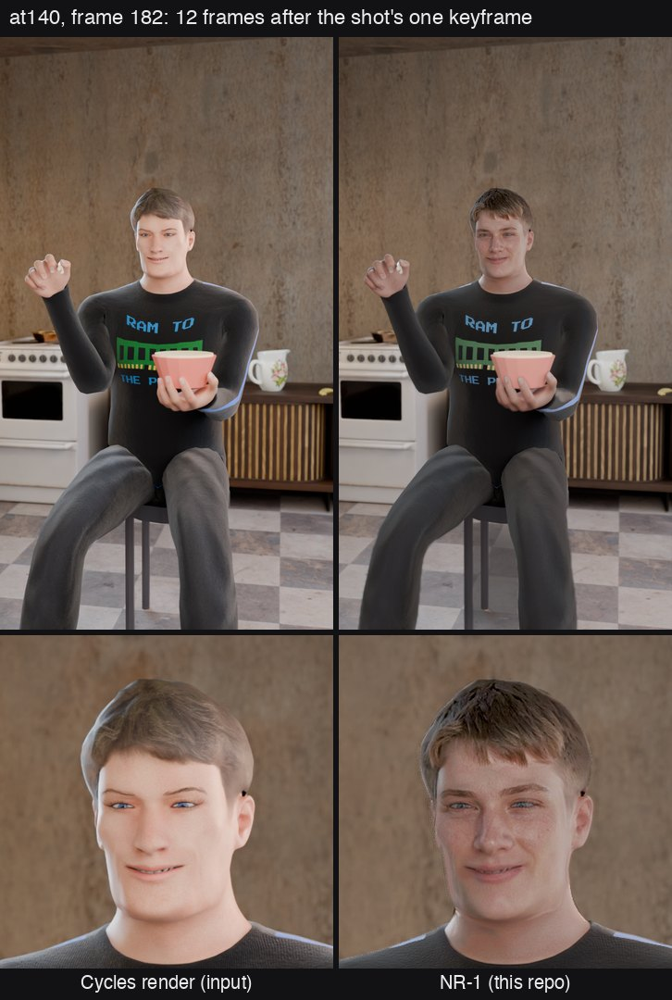
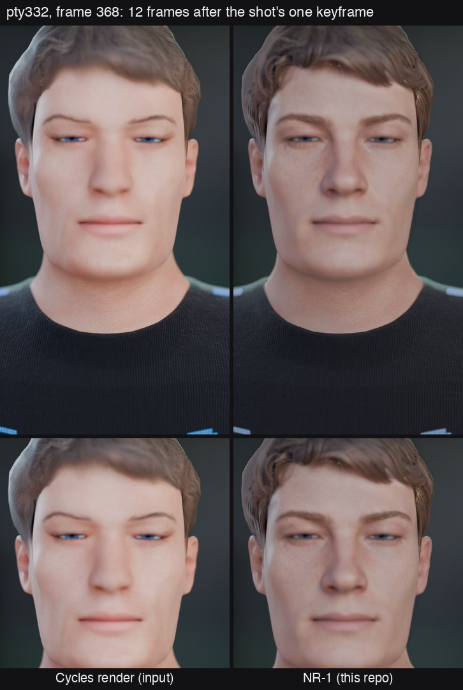
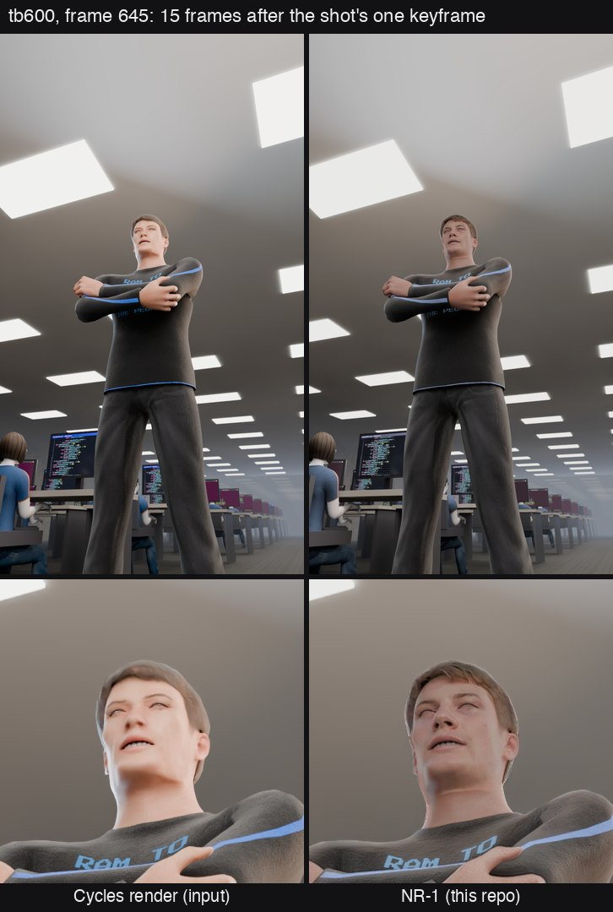
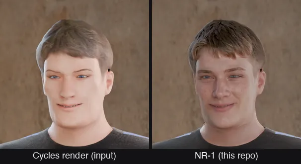

# nts-cycles: temporal neural rendering for Blender Cycles frame sequences

Clean-room, MIT. Research code from one production pipeline (vertical 1080×1920 character shorts rendered in
Cycles). It takes what an offline renderer gives for free (exact motion vectors, depth, region masks, hard cuts, which
bit of which surface every pixel shows) and uses it to make frames look more photographed, stay steady from frame to frame, upscale, and fill in frames.

No NVIDIA or AMD code, weights or binaries are used anywhere, and nothing here was trained on the output of a
proprietary upscaler. Where each design choice comes from is in [`PROVENANCE.md`](PROVENANCE.md) and
[`docs/DESIGN.md`](docs/DESIGN.md).



<sub>Left: the Cycles render NR-1 starts from. Right: NR-1 (this repo). Bottom row: the head at 1:1. Frame 182 is 12 frames after the shot's only generative keyframe; every frame in between finds
the keyframe's view of each bit of surface it shows (its surf pass) and takes the detail from there. More in [the gallery](docs/GALLERY.md).</sub>

## What is in here

| Job | Here | What it is | State |
|---|---|---|---|
| Realism pass (a more photographed look) | **NR-1**, `tools/nr_clip.sh` | Tone per region and shot (no network), ONE generative edit per shot (FLUX.2 klein 4B, Apache-2.0), its added detail carried through the shot by surface identity: every frame finds the keyframe's view of each surface point it shows | In production use (see Results) |
| Temporal upscaling, Quality / Balanced / Performance / Ultra Performance | **NTS-F**, `nts/pipeline.py` | Jittered temporal accumulation of a low-res render (same ×1.5 / ×1.71 / ×2 / ×3 ladder, `nts.conventions.QUALITY_MODES`), plus a native-res box around the head, so the face is never upscaled | Analytical, no weights. Modes are `render_lr.py` render modes |
| Anti-aliasing at native resolution | NTS-F at ×1 (`native_aa` render mode) | Native resolution, jittered, accumulated: anti-aliasing only | Analytical |
| Temporal upscaling in real time, on the GPU | **nts/rt** (new), [`docs/REALTIME.md`](docs/REALTIME.md) | NTS-F's accumulator as two WGSL compute passes (wgpu), fed what a game gives its upscaler; constants fitted to native renders | New. 0.44 ms per frame at 1080p Performance on an RTX 4050 laptop GPU and a GTX 1080; not yet in a game engine |
| Frame generation | **NTS-G**, `nts/framegen.py` (new) | 2× in-between frames. Surface mode: every pixel of the new frame finds its own bit of surface in the two neighbours, from a cheap surface-ID render of that frame. Vector mode: the neighbours' colours carried forward along the renderer's own two-way motion, nearest surface first | New. On at140 (58 frames, mean PSNR against the real rendered frame): surface mode 44.21 dB, vector mode 43.61 dB, blending the neighbours 36.12 dB; surface mode is ahead on 51 of the 58 frames. [Weak spot](docs/GALLERY.md#frame-generation-nts-g): fast, motion-blurred, defocused thin objects |
| Denoising | none | Use Cycles' own denoiser (OpenImageDenoise / OptiX) in the render | n/a |
| Learned upscaler | none | Upscaling here is NTS-F, which has no network. The recurrent networks we trained in research are not part of this repo | n/a |

The inputs are the buffers a real-time temporal upscaler is given: colour, depth, motion vectors, jitter offsets, a
reset flag on cuts, exposure. They come out of Cycles as passes; see [`docs/INTEGRATION.md`](docs/INTEGRATION.md).

## Results

**Steadiness** (build e9, every frame of the 8 test clips rendered from the current scene, `eval/nr_board.py`).
Flicker is the mean change from one frame to the next along the renderer's exact motion, in 8-bit levels, with newly
visible pixels left out (`eval/flicker_mv.py`). Lower is steadier. NR-1 is shown next to the Cycles render it starts
from. Part of the render's flicker is sampling noise, which the steadied base removes; the point of the table is that
the generative detail NR-1 adds does not bring flicker back.

| clip | face flicker, render | face flicker, NR-1 | face p90, render | face p90, NR-1 | whole frame, render | whole frame, NR-1 |
|---|---|---|---|---|---|---|
| at140 | 1.36 | **0.79** | 2.74 | **1.41** | 0.42 | **0.18** |
| pty332 | 0.80 | **0.50** | 1.82 | **0.89** | 0.72 | **0.42** |
| rs345 | 1.24 | **0.62** | 2.44 | **1.03** | 0.37 | **0.14** |
| zd400 | 1.42 | **0.71** | 2.80 | **1.20** | 0.42 | **0.19** |
| hp622 | 1.47 | **0.79** | 2.87 | **1.33** | 0.44 | **0.17** |
| su290 | 1.15 | **0.64** | 2.13 | **1.06** | 0.41 | **0.15** |
| tb600 | 1.85 | **0.79** | 4.12 | **1.39** | 0.52 | **0.26** |
| ti620 | 1.67 | **0.80** | 3.52 | **1.46** | 0.24 | **0.09** |
| mean | 1.37 | **0.70** | 2.80 | **1.22** | 0.44 | **0.20** |

hp622, su290, tb600 and ti620 come from episodes and sets added after the pipeline was first tuned. They are not
strictly held out: three fixes to the carry and compose were made after failures seen on them (2026-11-22), and the
carry's offset rule was chosen on hp622 and pty332 (2026-11-27).

## Gallery

| | |
|---|---|
|  |  |

Head crops in motion (at140, frames 172-199; render, NR-1):



All eight test clips and the frame-generation check: [`docs/GALLERY.md`](docs/GALLERY.md).

## Speed

The CPU stages were sped up without changing a single output byte: the same frames, compared file by file, at any
worker or thread count ([`docs/SPEED.md`](docs/SPEED.md)). The filters are leaner (cumulative sums read by slices,
a 256-entry sRGB table), each motion field's lookups are worked out once and shared, and frames that do not depend on
each other run in parallel.

On at140, on our render box (shared with other jobs, so wall times are noisy; CPU time in brackets):

| stage | before | after, 1 process | after, parallel |
|---|---|---|---|
| steadied base, 10 frames (`gen.steady2`) | 164 s (55 s) | 130 s (45 s) | **104 s**, `--threads 3` |
| tone, 60 frames (`nts.tone`) | 682 s (422 s) | 548 s (298 s) | **256 s**, `--workers 4` |
| carry + compose, 60 frames (`gen.carry --surf`, 2026-11-26) | — | 904 s (450 s) | **264 s**, `--workers 4` |

Parallel use: `--workers N` on `nts.tone`, `gen.carry`, `nts.framegen` (or `export NTS_WORKERS=N`; `0` = one per
core), `--threads N` on `gen.steady2` (default 3, `NTS_THREADS`). Each tone or carry worker needs about 1.4 GB; the
steadier needs 2.5 GB with one thread and 3.2 GB with three.

## Quick start

```bash
git clone <this repo> && cd nts-cycles
python -m venv .venv && . .venv/bin/activate
pip install -e ".[exr,dev]"          # numpy, Pillow, OpenImageIO, pytest
pytest                               # synthetic tests, no data needed
python -m nts.tone smoke             # the tone step on a synthetic shot
```

On your own Cycles render (passes from `datagen/blender/render_lr.py`: `f_####.exr` with Image, Depth, Vector and
Region, plus `jitter.json`, `cuts.json`, `meta.json`; frames as `f_####.png`, Region masks as `m_####.png`; for the
carry and NTS-G surface mode also the surf pass, render mode `surf`, a separate `f_####.exr` set):

```bash
# NR-1, the analytical part (no GPU): steadied base, then tone (needs the look brief, see "State, honestly")
python -m gen.steady2 <geom_exr_dir> <frames> <frames> out/base --bands 2 --energy-alpha 0.2 --fine-alpha 0.08 \
    --fine-tol 40 --edge-reset 12
python -m nts.tone apply out/base <masks> out/tone --geom <geom_exr_dir> --tone 0.7 --share-power 0.5 \
    --rest-tone 1.0 --garment-tone 0.8 --garment-curve 1.8 --skin-rim --skin-close --shot-hold \
    --weights-out out/tone_w --workers 0
# NTS-G: check frame generation on a fully rendered clip, then fill the gaps of a half-rate render
python -m nts.framegen <geom_exr_dir> <frames> --check --workers 0
python -m nts.framegen <geom_exr_dir> <frames_every_other> out/inbetween --workers 0
# NTS-G surface mode: the surf pass (render_lr.py mode "surf") of EVERY frame, the full render of every other one
python -m nts.framegen <surf_exr_dir> <frames_every_other> out/inbetween --surf --geom <geom_exr_dir> --workers 0
# NTS-F: upscale a jittered low-res render (render mode quality / balanced / performance / ultra_performance / native_aa)
python -m nts.pipeline <lr_render_dir> none out/upscaled
```

The keyframe edit (`tools/nr_clip.sh keys`) needs the generative model on a GPU; the scripts here run it on a Kaggle
T4 (`tools/kaggle/run_pilot.py`, about 10 s per key). The carry that follows (`gen.carry --surf <surf_exr_dir>`,
`--workers N`) is CPU.

## How NR-1 works

```
Cycles render + Vector + Depth + Region mask (face / hands / hair) + cuts      datagen/blender/render_lr.py
  + surf pass: each pixel's object and surface coordinates (UV, Generated)      render_lr.py mode "surf"
  -> steadied base: coarse band accumulated along the true motion, fine band held     gen/steady2.py
  -> tone: one monotone lightness curve, chroma scale and hue shift per region and shot  nts/tone.py   (numpy, no network)
  -> structure: ONE generative keyframe edit per shot (FLUX.2 klein 4B, Apache-2.0)   tools/kaggle/run_pilot.py
  -> carry: every frame looks up where the keyframe shows each of its surface points    gen/carry.py
            and takes the key's added detail from there, composed onto the toned frame  nts/surface.py
  -> lens, grain, the show's own finishing step                                       nts/finish.py
```

The generative model sees one frame per shot, so it cannot flicker, and the tone step uses constants per shot, so it
cannot change a face's shape. A 1,800-frame episode needs a few minutes of a 16 GB GPU for the keys; everything else
is CPU (numpy, Pillow, OpenImageIO). Drivers: `tools/nr_clip.sh` (one clip), `tools/nr_episode.sh` (a whole episode).
Both call a few job scripts on the render box (`runs/v2_*` there; this repo keeps them in `runs/4050/`).

**NTS-F** (`nts/pipeline.py`): a jittered low-res render of the whole frame is upscaled by jittered temporal
accumulation (`baselines/accumulate.py`), and a natively rendered box around the head is laid over it.

**NTS-G** (`nts/framegen.py`): an offline renderer can say which bit of which surface every pixel shows. In surface
mode each pixel of the frame to generate looks its own surface point up in its two neighbours (`nts/surface.py`), so
outlines are that frame's own. In vector mode, Cycles' Vector pass (each pixel's motion to the previous AND the next
frame) carries the neighbours' colours forward from both sides, and depth decides which surface is in front.

**Evaluation** (`eval/`): true-motion flicker and follow ratio from the renderer's own motion (`flicker_mv.py`), a
scoreboard (`nr_board.py`), and a blind A/B page builder (`abtest.py`).

## State, honestly

- It runs our pipeline; parts of it are not a packaged tool. The shell drivers assume our layout: a render box reached
  over ssh (`NTS_HOST`), a second box (`NTS_HOST2`), a Kaggle account (`KAGGLE_USER`) for the keyframe edit.
- It needs a scene that renders the passes above. `datagen/blender/render_lr.py` is the Blender side; the scene
  project it hooks into is not part of this repo, and neither are the renders, photos or model weights.
- The tone step reads a frozen look brief (`data/look/brief_v1.json`: a few hundred relative region statistics, no
  pixels; how it was made is in `PROVENANCE.md`, "The look"). It is not in this repo; `eval/look_brief.py` makes one
  from your own reference, and `python -m nts.tone smoke` shows the format.
- Frame generation is new (2026-11-24) and checked on one clip; it has not been through an A/B.
- The frames in `docs/media` are our own renders and our own outputs; no third-party upscaler's output is published
  here. This project is not affiliated with NVIDIA or AMD.

## Layout

| Folder | What |
|---|---|
| `nts/` | tone, finish, warps, EXR input, surface correspondence, NTS-F pipeline, NTS-G frame generation, parallel helpers |
| `gen/` | steadying, keyframe carry, structure, the generative teacher |
| `datagen/` | Blender render hooks (render modes, passes) and render jobs |
| `eval/` | metrics, scoreboard, A/B tools |
| `tools/` | drivers, Kaggle kernel scripts, gallery builder, photo fetchers (CC0 / CC-BY / public domain only) |
| `looks/` | material looks for the render |
| `docs/` | gallery, speed notes, integration guide, design notes |

## Tests

`pytest` (or each file as a script: `python tests/test_speed_equivalence.py`). Covered: the jitter / splat / warp
conventions, the byte-exactness of every sped-up primitive against the code it replaced, surface correspondence, frame
generation (both modes) and the quality-mode ladder on synthetic scenes, and `python -m nts.tone smoke`.
`tests/test_metrics.py` needs the calibration renders and skips without them.

## Licence

MIT ([`LICENSE`](LICENSE)). FLUX.2 klein 4B is not part of this repo: the kernel script fetches it from Hugging Face,
under its own Apache-2.0 licence.
