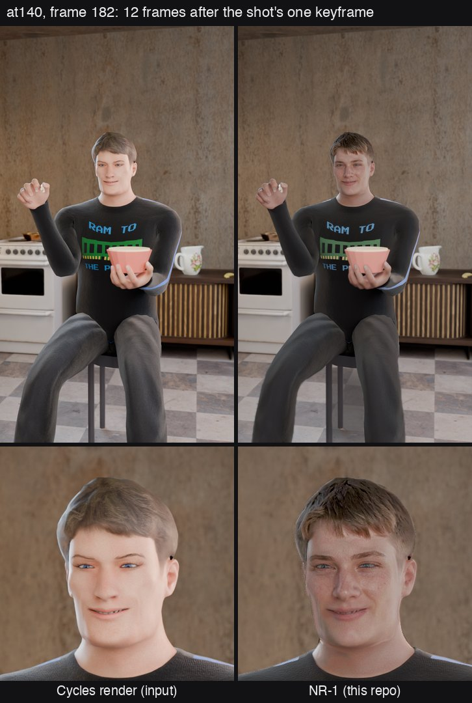
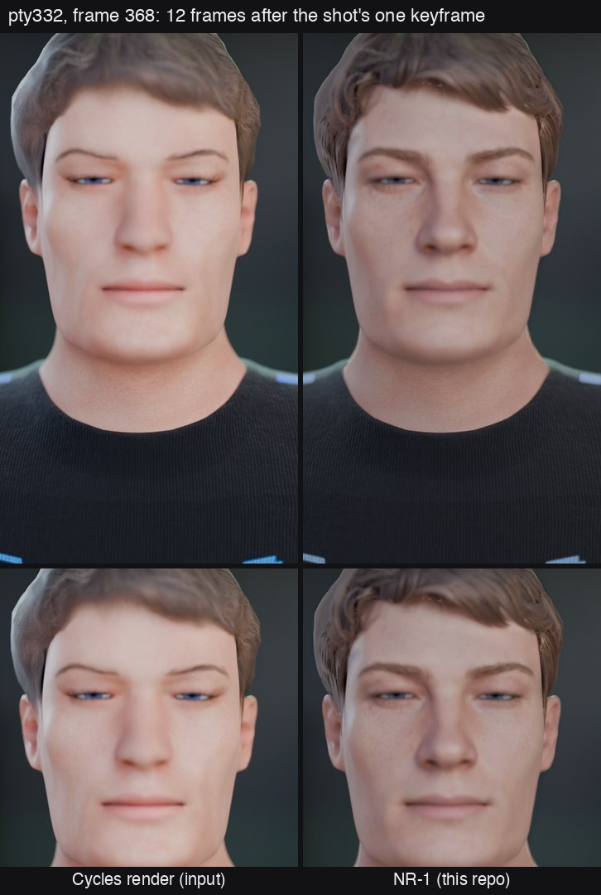
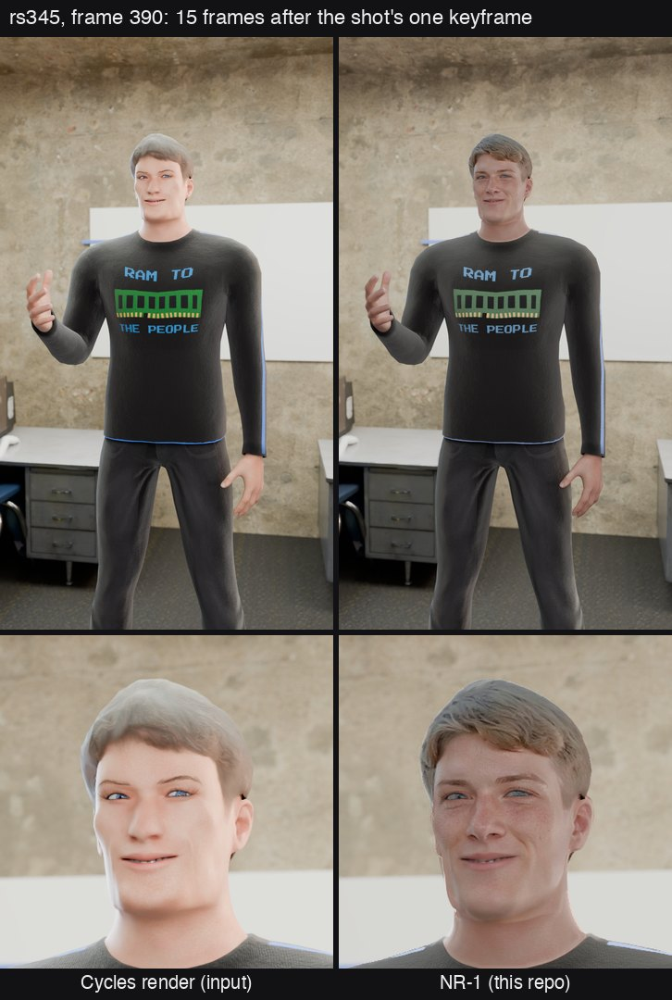
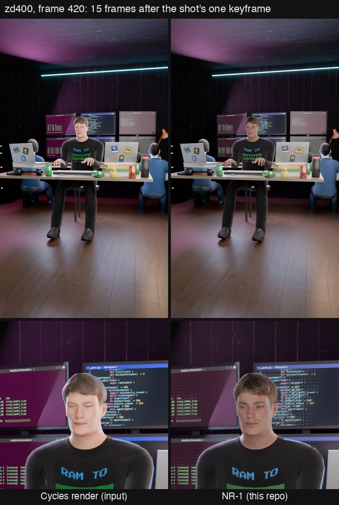
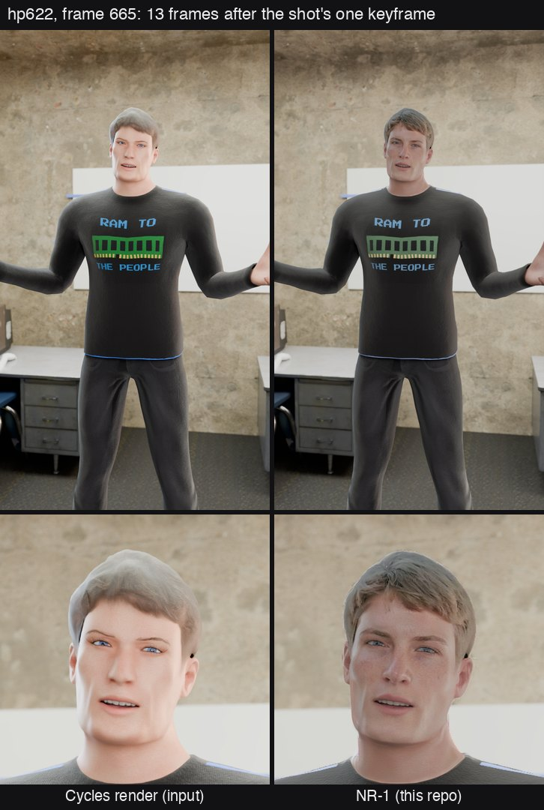
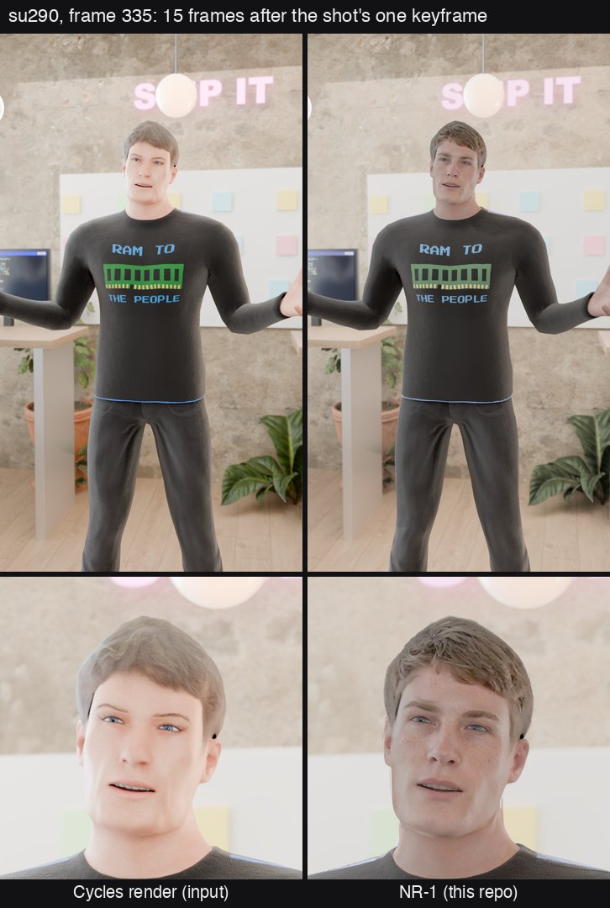
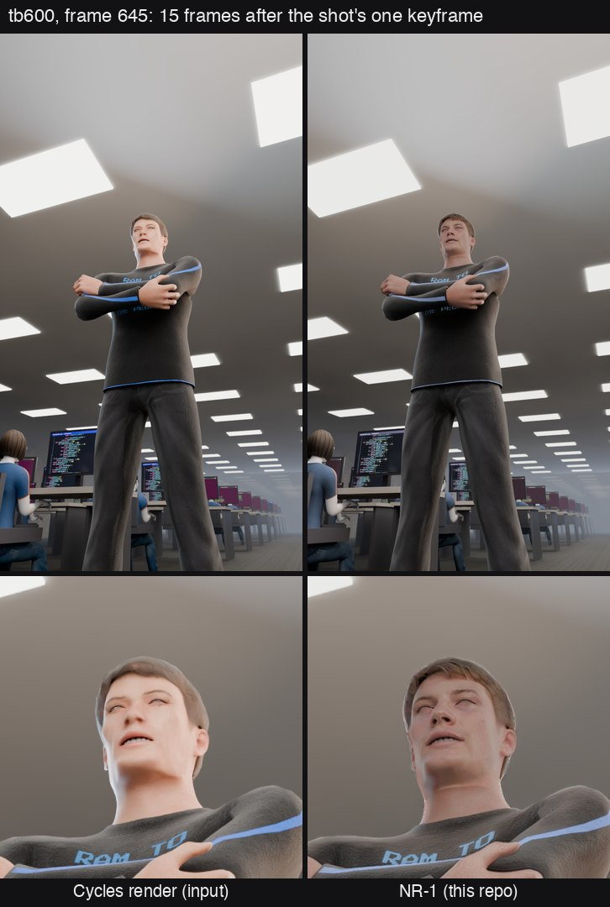
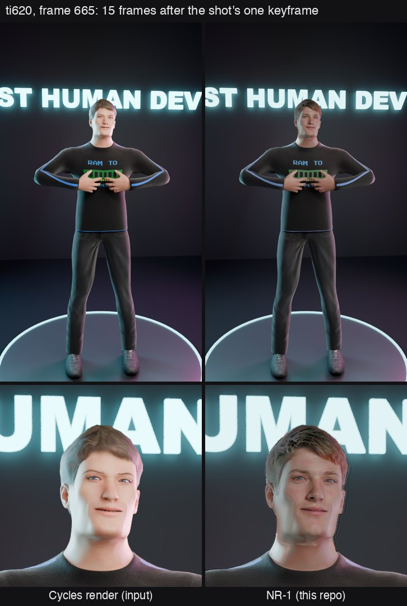
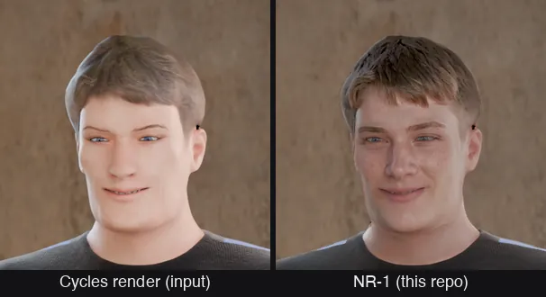
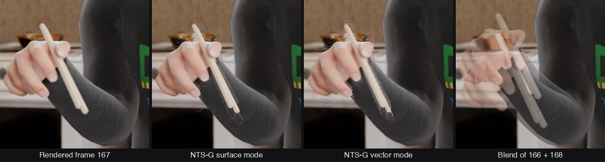

# Gallery

Every panel: the Cycles render NR-1 starts from (left) and NR-1 from this repo (right). Top row: the whole 1080×1920 frame, scaled down. Bottom row: the head at 1:1, cropped where the render's
Region mask puts the face and hair. NR-1 makes one generative edit per shot, on a keyframe; each frame shown here is
10 to 15 frames after that keyframe, so what you see was carried there by surface identity and is not a fresh edit.

The NR-1 frames are build e9, the build scored in the README. hp622, su290, tb600 and ti620 come from episodes and
sets added later; they are not strictly held out (see the README's Results). Panels are made with `tools/gallery.py`.

| clip | frame | keyframe |
|---|---|---|
| at140 | 182 | 170 |
| pty332 | 368 | 356 |
| rs345 | 390 | 375 |
| zd400 | 420 | 405 |
| hp622 (added later) | 665 | 652 |
| su290 (added later) | 335 | 320 |
| tb600 (added later) | 645 | 630 |
| ti620 (added later) | 665 | 650 |

## In motion

at140, frames 172-199 at 12 fps, the head crop: render, NR-1. Stills cannot show flicker; this can.
[MP4 version](media/at140_head_motion.mp4).

## Frame generation (NTS-G)

`python -m nts.framegen <exr_dir> <frames> --check` generates every frame of a fully rendered clip from its two
neighbours and compares it with the real frame. at140, rendered again from today's scene (at140n, the native
1080×1920 Cycles render as Blender saved it), all 58 frames that have both neighbours in the same shot:

| | mean PSNR against the real frame |
|---|---|
| NTS-G surface mode (the in-between frame's surf pass, `--surf --geom`) | **44.21 dB** (median 44.23, worst 41.43) |
| NTS-G vector mode (no extra render) | 43.61 dB (median 43.51, worst 40.57) |
| plain blend of frames n−1 and n+1 | 36.12 dB |

Surface mode beats vector mode on 51 of the 58 frames (by 0.26 dB at most where it loses), and both beat the blend on
every frame. The worst frame of the clip for both is 167: a hand with chopsticks moving fast in front of the
camera's focus, so its outline in the real frame is soft. A generated frame there has rougher outlines than the
render (each pixel of the neighbours carries one depth and one motion, while a defocused outline mixes the hand and
what is behind it); surface mode's outlines are the in-between frame's own and come out cleaner. The blend (right)
shows the double image frame generation exists to avoid.

Where it holds up: rigid and skinned motion under unchanging light, anything the surf pass or Cycles' Vector pass
describes. Where it does not: thin objects under heavy motion blur or defocus (above), light that changes between the
two frames (it averages them), and surface that neither neighbour shows (vector mode fills it in from around it).
